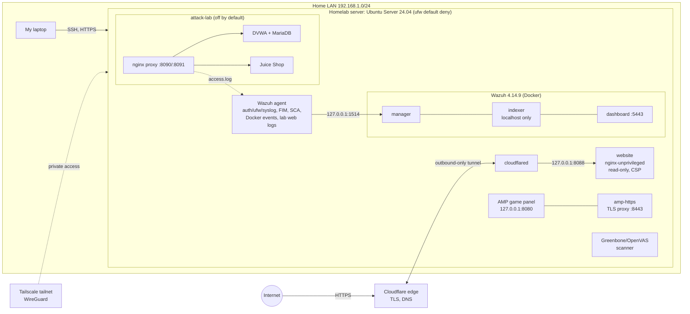

# homelab

My self-hosted cybersecurity homelab: one Ubuntu Server 24.04 box that I harden, monitor
with a SIEM, attack on purpose, and use to host my portfolio site with **zero open ports**.

**Portfolio:** [osvaldomarino.dev](https://osvaldomarino.dev) · **Contact:** contact@osvaldomarino.dev ·
[LinkedIn](https://www.linkedin.com/in/omarino1)

> All configs here are **sanitized examples**: no secrets, keys, tunnel IDs or real
> public/Tailscale addresses. See [SECURITY.md](SECURITY.md).

## Results at a glance

| What | Result |
|---|---|
| Greenbone/OpenVAS vulnerability scan | **9 Medium/Low findings → 1** (a documented false positive). **0 Critical / 0 High** before and after. [Write-up](docs/hardening-greenbone.md) |
| Outside-in exposure check | **0 of 1,007** IPv4 TCP ports open; IPv6 tested ports all blocked. [Write-up](docs/external-exposure-check.md) |
| Wazuh SIEM detections | SSH brute force (rules 5710 → 5712), real-time file integrity on `/etc` (554/550/553), UNION-based SQL injection (31106). **Missed** the boolean `OR '1'='1'` SQLi, documented honestly. [Write-up](docs/wazuh-soc-lab.md) |
| CIS Ubuntu 24.04 benchmark (Wazuh SCA) | **50%** on the first scan, a baseline to improve on |
| Website | Static site in a non-root, read-only nginx container behind Cloudflare Tunnel, strict CSP, no inbound firewall rule |

## Architecture



The lab apps sit on a Docker `internal: true` network with no internet egress; only the
proxy is reachable, and only from the server itself or over Tailscale.

## Components

| Directory | What it is | Key decisions |
|---|---|---|
| [`website/`](website/) | Portfolio site: `nginxinc/nginx-unprivileged` + Cloudflare Tunnel | UID 101, `read_only`, `cap_drop: ALL`, `no-new-privileges`, tmpfs, CPU/memory/PID limits, bound to `127.0.0.1` only. Headers: CSP `default-src 'none'`, `nosniff`, `X-Frame-Options DENY`, Referrer-Policy, Permissions-Policy, COOP. GET/HEAD only, dotfiles blocked. Tunnel is outbound, so **no port forward and no ufw rule**. |
| [`host-hardening/ssh/`](host-hardening/ssh/) | sshd crypto drop-in | Removes `umac-64` and SHA-1 MACs; post-quantum hybrid `sntrup761x25519` KEX first; AEAD/CTR ciphers only. Applied with `sshd -t` + reload, tested a new login before closing the old session. |
| [`host-hardening/ufw/`](host-hardening/ufw/) | Firewall rules | Default deny inbound; admin ports LAN-only; rules in `before.rules` so a later broad `allow` can't reopen weak services; ICMP timestamp requests dropped. |
| [`host-hardening/sysctl/`](host-hardening/sysctl/) | Kernel setting | `net.ipv4.tcp_timestamps = 0` to stop leaking uptime. |
| [`amp-https/`](amp-https/) | TLS reverse proxy for the game panel | Moves a cleartext HTTP login to HTTPS (TLS 1.2/1.3, ECDHE + AEAD only, HSTS, WebSockets). Same hardened container profile as the website. |
| [`wazuh/`](wazuh/) | Single-node Wazuh SIEM + agent config | Ports bound to specific interfaces (Docker bypasses ufw); indexer and API localhost-only; demo passwords replaced **before first boot**; real-time FIM on `/etc`; CIS benchmark via SCA; Docker listener. |
| [`attack-lab/`](attack-lab/) | DVWA + OWASP Juice Shop practice lab | `internal` network (egress test failed as intended), resource limits, `restart: "no"`, `lab up/down/status/logs` helper. Proxy access log feeds Wazuh. |
| [`docs/`](docs/) | Write-ups | Greenbone before/after, Wazuh SOC lab, external exposure check. |

## Security decisions worth calling out

1. **Exposure first, then crypto.** When a vendor's SFTP server couldn't drop weak algorithms,
   I limited it to Tailscale-only in `before.rules` and documented the residual risk instead of pretending it was fixed.
2. **Don't trust Docker + ufw.** Docker-published ports skip ufw, so every service binds to an explicit address and I verify with `ss`.
3. **False positives get evidence, not silence.** The one remaining Greenbone Medium is a single-page app returning its login page (HTTP 200) for every path; I proved it and documented it.
4. **Detection has gaps.** Wazuh caught the UNION SQLi but not `OR '1'='1'`. Next: a custom rule or ModSecurity + OWASP CRS.
5. **Change safely.** Back up every file, change one control at a time, keep an SSH lifeline open, and rescan to verify.

## Repository layout

```
homelab/
├── README.md, SECURITY.md, LICENSE, .gitignore
├── docs/          hardening-greenbone.md, wazuh-soc-lab.md, external-exposure-check.md
├── website/       compose.yaml, nginx/default.conf, cloudflared/config.example.yml
├── host-hardening/ssh/40-crypto-hardening.conf
│                  sysctl/99-homelab-tcp-timestamps.conf
│                  ufw/before.rules.snippet, ufw/ufw-rules.md
├── amp-https/     compose.yaml, nginx/amp.conf, certs/README.md
├── wazuh/         docker-compose.yml, .env.example, agent-ossec.conf.snippet.xml
└── attack-lab/    compose.yaml, .env.example, nginx/lab.conf, lab
```

## Tools
Linux · ufw · Tailscale · Greenbone/OpenVAS · Nmap · Docker · Wazuh · nginx · Cloudflare Tunnel

## Next steps
- Trusted certificate for the panel via `tailscale serve`
- Greenbone override for the documented false positive
- Custom Wazuh rule / WAF for the missed SQLi variant
- Raise the CIS benchmark score above 50%

---
Built by **Osvaldo Marino**, a cybersecurity student at Georgia State University, currently studying for CompTIA Security+.
Licensed under [MIT](LICENSE).
