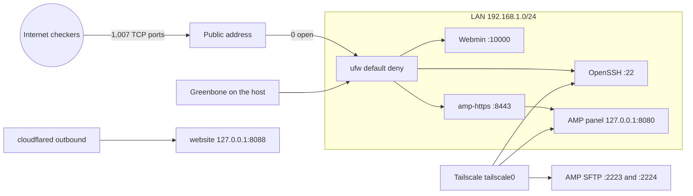

# Plan: Hardening and exposure

**Phase:** plan. Written 2026-11-06 against the configs and write-ups already in the repo. Spec: [spec.md](spec.md). Tasks: [tasks.md](tasks.md).

## Stack

| Piece | Role |
|---|---|
| Ubuntu Server 24.04 | Homelab host |
| OpenSSH drop-in | Explicit MACs, key exchange, and ciphers |
| ufw | Default deny inbound. Admin ports limited to the LAN. Early drops in `before.rules`. |
| sysctl | `net.ipv4.tcp_timestamps = 0` |
| Greenbone Community Edition (OpenVAS) in Docker on the same host | Before/after vulnerability scan |
| Tailscale (`tailscale0`) | Private path for admin access and for services that cannot be hardened in place |
| Public checkers (portchecker.io, check-host.net, pingie.net) | Outside-in exposure check |
| [`amp-https/`](../../amp-https/) | Shared infrastructure. TLS reverse proxy for the AMP panel. |
| [`website/`](../../website/) | Shared infrastructure. Static site behind an outbound Cloudflare Tunnel. No inbound port. |

The host also runs Webmin (port 10000, LAN-only) and a Minecraft listener (port 25566, not port-forwarded on the router). Those are in [host-hardening/ufw/ufw-rules.md](../../host-hardening/ufw/ufw-rules.md). They were not findings in the Greenbone write-up.

## Architecture

Two different exposure limits show up in the diagram:

- From the internet, the measured TCP surface on 2026-10-20 was 0 of 1,007 ports. The website does not change that picture: nginx binds `127.0.0.1:8088` and Cloudflare Tunnel dials out, so [host-hardening/ufw/ufw-rules.md](../../host-hardening/ufw/ufw-rules.md) has no website rule. The exposure write-up notes the site was added later that day and the external scan was not re-run.
- From the LAN, weak AMP SFTP stays up only for tailnet peers. Plain HTTP on 8080 stays up only on loopback (the proxy) and on `tailscale0`. The LAN rule for the panel is 8443, not 8080.

`before.rules` is evaluated before user rules from `ufw allow`, so a later broad allow cannot reopen 2223, 2224, or 8080. The snippet also drops ICMP timestamp requests. Loopback is already accepted by the stock ufw rule, which is why the proxy on the host can still reach 8080.

## Controls and the files that implement them

| Control | File | Write-up |
|---|---|---|
| SSH MACs, KEX (`sntrup761x25519` first), AEAD and CTR ciphers | [host-hardening/ssh/40-crypto-hardening.conf](../../host-hardening/ssh/40-crypto-hardening.conf) | [Hardening, section D](../../docs/hardening-greenbone.md) |
| ICMP type 13 drop; SFTP only on `tailscale0`; 8080 only on Tailscale (loopback already accepted) | [host-hardening/ufw/before.rules.snippet](../../host-hardening/ufw/before.rules.snippet) | [Hardening, sections A and F](../../docs/hardening-greenbone.md) |
| Default deny, LAN-only 22 / 10000 / 8443, Tailscale, and the Docker-bypass note | [host-hardening/ufw/ufw-rules.md](../../host-hardening/ufw/ufw-rules.md) | same |
| TCP timestamps off | [host-hardening/sysctl/99-homelab-tcp-timestamps.conf](../../host-hardening/sysctl/99-homelab-tcp-timestamps.conf) | [Hardening, section E](../../docs/hardening-greenbone.md) |
| Panel TLS proxy: TLS 1.2/1.3, ECDHE plus AES-GCM or ChaCha20, HSTS, WebSocket upgrade, non-root read-only nginx | [amp-https/compose.yaml](../../amp-https/compose.yaml), [amp-https/nginx/amp.conf](../../amp-https/nginx/amp.conf) | [Hardening, section B](../../docs/hardening-greenbone.md) |
| Self-signed certificate, key not in git | [amp-https/certs/README.md](../../amp-https/certs/README.md) | same |
| Outside-in method, results, and caveats | — | [docs/external-exposure-check.md](../../docs/external-exposure-check.md) |
| Outbound tunnel and localhost bind for the public site | [website/compose.yaml](../../website/compose.yaml), [website/cloudflared/config.example.yml](../../website/cloudflared/config.example.yml) | README architecture |

Scan exports (`greenbone-server-scan-20261020-0637` and `greenbone-server-rescan-20261020-2348`, pdf/csv/txt/xml) are named in the write-up and are not in this repository. pdf, csv, and xml exports are gitignored.

## Change order

The write-up's method is the order that was used: back up each file (`*.bak-20261020` on the host, not committed), change one control, confirm SSH and the panel, then rescan. The sshd change was a reload after `sshd -t`, with a new login verified before the old session was closed.

## Residual risk the plan keeps visible

- AMP SFTP still negotiates weak algorithms for any device already on the tailnet.
- The panel certificate is self-signed, so browsers warn once.
- Greenbone still reports the single-page-app 200 as a Medium until an override exists.
- External coverage is 1,007 TCP ports and 16 common IPv6 ports per address. It is not a full port sweep, and UDP was not tested from outside.
