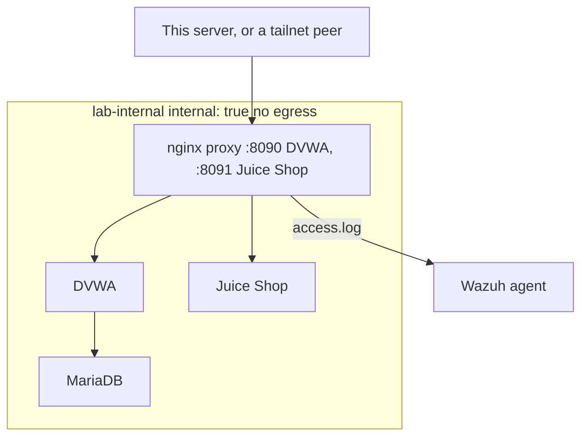

# Plan: Attack lab and incident report

**Phase:** plan. Written 2026-11-06 against the lab already in the repo. Spec: [spec.md](spec.md). Tasks: [tasks.md](tasks.md).

## Stack

| Piece | Role |
|---|---|
| `ghcr.io/digininja/dvwa` | Deliberately vulnerable PHP app. `DEFAULT_SECURITY_LEVEL=low` for the tests that were run. |
| `mariadb:11` | DVWA database, on the internal network only |
| `bkimminich/juice-shop` | Second deliberately vulnerable app |
| `nginx:alpine` proxy | The only reachable lab container. Publishes 8090 and 8091. |
| `lab` helper | `up`, `down`, `status`, `logs` |
| Wazuh agent localfile | Reads the proxy access log. Detection rules are specified in the [Wazuh plan](../02-wazuh-detection/plan.md). |

Secrets and the Tailscale address come from an uncommitted `.env`. The committed template is [attack-lab/.env.example](../../attack-lab/.env.example) (`TAILSCALE_IP=100.x.y.z` and `change-me-random` passwords).

## Architecture

From [attack-lab/compose.yaml](../../attack-lab/compose.yaml):

- `lab-internal` is `internal: true`. DVWA, MariaDB, and Juice Shop have no other network. The proxy joins `lab-internal` and `lab-edge`. `lab-edge` is what gives the proxy its published ports.
- Published ports are `127.0.0.1:8090`, `${TAILSCALE_IP}:8090`, `127.0.0.1:8091`, and `${TAILSCALE_IP}:8091`. There is no `0.0.0.0` bind and no LAN bind.
- Caps: DVWA 256 MB, MariaDB 384 MB, Juice Shop 512 MB, proxy 64 MB. CPU and PID limits are set in the same file. Every service uses `restart: "no"`.
- The proxy mounts [attack-lab/nginx/lab.conf](../../attack-lab/nginx/lab.conf) read-only and writes logs under `./logs/nginx`, which is gitignored.

On the server the stack lives at `/opt/attack-lab/`. The Wazuh agent snippet points at `/opt/attack-lab/logs/nginx/access.log` with `apache` format. That path is how a request becomes rule 31103, 31106, 31151, or 100101.

The [lab](../../attack-lab/lab) script is the operator interface: `lab up` starts the stack and prints the two localhost URLs, `lab down` runs `docker compose down`, `lab status` prints `docker compose ps`, and `lab logs` follows the access log. DVWA's well-known default credentials are used only inside this lab. The script tells the operator to reset the DVWA database once after startup. The incident timeline's "database reset, security level low" step is that setup, and the report treats it as benign.

## Attack path that was executed

The report's appendix is the order of operations. Summarized:

1. `lab up`, poll until the apps return HTTP 200.
2. Nmap service and script scan of 8090 and 8091 on the server's own Tailscale address.
3. Authenticated DVWA requests at security level low: UNION SQLi, three boolean SQLi variants, reflected XSS, and LFI.
4. Juice Shop: one POST login whose payload is in the JSON body, and one GET search whose payload is in the query string.
5. `lab down`, then confirm no containers and nothing listening on 8090 or 8091.

Source addresses in the report are redacted to `<server-ts-ip>`. That address was both the attacker and the proxy listen address. No packet left toward a third party. The internal network has no default route off the host.

## Why the POST was missed, in this architecture

The proxy log is an access log. Wazuh's web rules, including 100100, match the URL the decoder extracted. `POST /rest/user/login` with `{"email":"' OR 1=1--"}` stores the injection in the body, so the URL never contains the pattern. The report's fix for that gap is a WAF or other body inspection in front of the lab. The scheduled implementation is ModSecurity with the OWASP Core Rule Set, in [tasks.md](tasks.md).

A port scan that does not send HTTP is a different gap. It is scheduled as Suricata on the [Wazuh task list](../02-wazuh-detection/tasks.md), because the events have to land in the SIEM.

## Write-ups and configs

| Artifact | Path |
|---|---|
| Compose stack | [attack-lab/compose.yaml](../../attack-lab/compose.yaml) |
| Proxy config | [attack-lab/nginx/lab.conf](../../attack-lab/nginx/lab.conf) |
| Helper script | [attack-lab/lab](../../attack-lab/lab) |
| Environment template | [attack-lab/.env.example](../../attack-lab/.env.example) |
| How the lab was built and first tested | [docs/wazuh-soc-lab.md](../../docs/wazuh-soc-lab.md) |
| Full incident report | [docs/incident-report-simulated-attack.md](../../docs/incident-report-simulated-attack.md) |
| Boolean rule the report relied on | [docs/wazuh-custom-rule-boolean-sqli.md](../../docs/wazuh-custom-rule-boolean-sqli.md) |
